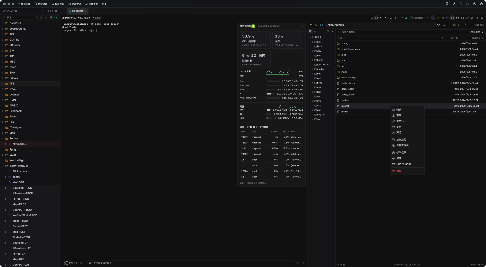

# iBorShell

[](https://github.com/robprian/net.iborshell/actions/workflows/ci.yml)
[](https://github.com/robprian/net.iborshell/releases)

iBorShell (`net.iborshell`) is a DBX plugin that turns a connection into a full
server workspace: interactive terminal, SFTP file transfer, jump-host access,
guarded elevation, and MCP automation — without losing context. It is a repack
of the DBX SSH plugin with a leaner terminal surface and a few additions aimed
at day-to-day operations work.

> Terminal · SFTP · Remote Operations: one DBX workspace for interactive terminals, files, automation, and guarded server operations.

## What is different in iBorShell

- **Multi Exec** — pick any set of currently connected sessions and run one
  command on all of them in parallel, with per-host output, exit codes, and
  timing collected in a single panel. Optional sudo, off by default.
- **Clone session** — duplicate the current session tab over the already
  authenticated SSH transport: an independent terminal, no second MFA prompt.
- **Live stats strip** — the terminal toolbar shows live server CPU, disk
  usage (root mount), and round-trip ping for the active session, refreshed
  every 3 seconds while connected.
- **No history panel** — the Warp-style floating command-history panel was
  removed to keep the terminal surface minimal. Inline suggestions and the
  ghost text still learn from your command history, and the per-connection
  history limit remains configurable under *Settings → Command history*.

Everything else — PTY terminal, SFTP, ProxyJump (up to three hops), Known
Hosts verification, read-only mode, command allowlists, and the MCP toolset —
behaves as in the upstream plugin.

## See it in action

[Watch the 87-second live workflow demo (click to play)](docs/media/dbx-ssh-live-demo.mp4) ·
[Watch the 15-second feature preview](docs/media/dbx-ssh-demo.mp4)



## Why teams reach for it

| Your job | The iBorShell workflow |
| --- | --- |
| Resolve an incident quickly | PTY terminal, quick commands, cancellable commands, directory tracking, plus Multi Exec fan-out across hosts |
| Move files safely | SFTP preview, drag and drop, progress, cancellation, acknowledgements, and atomic replacement |
| Reach private servers | Up to three ProxyJump hops, keepalive, and Known Hosts verification |
| Put guardrails around risk | Read-only mode, selectable sudo source, command allowlists, and host secret bindings |
| Automate repeatable work | MCP tools that reuse connections, approvals, and permission boundaries |

## Highlights

- Password, private-key, SSH Agent, keyboard-interactive, and passwordless authentication.
- Interactive PTY terminal with resize, session recovery, clipboard support,
  remote-directory tracking, and batch input.
- **Clone session** (formerly "Duplicate session") opens an independent
  terminal over the current authenticated SSH transport without asking for
  MFA again; **New session** still creates and authenticates a fresh transport.
- SFTP browsing, sorting, preview, upload, download, rename, create, drag and drop,
  and recursive delete. Focus the SFTP pane and press Ctrl/Cmd+V to upload local
  files from the system clipboard into the current directory.
- Docker panel, server metrics, tunnels, and RDP sessions are included as in upstream.

## Install

1. Download `net.iborshell.dbxp` from the
   [latest release](https://github.com/robprian/net.iborshell/releases/latest).
2. Install it in DBX as a local plugin package.

### Package signature

Release packages are signed with Ed25519. The signing key id is `epg359`:

```
key_id:     epg359
public key: QXx2cx1hngx9hcCpxOasima9kJ9Cjuc+4oR9Zj5u+lY=
```

To install as a *LocalSigned* package instead of *LocalDevelopment*, add the
public key to your DBX plugin trust store at
`<plugin-store>/.trust/keys.json`:

```json
{ "epg359": "QXx2cx1hngx9hcCpxOasima9kJ9Cjuc+4oR9Zj5u+lY=" }
```

The `.artifact.json` published next to each `.dbxp` records the target,
SHA-256, size, and the signing key id of the signed package.

## Build from source

Requires Node.js 22 (see `.nvmrc`), pnpm, and a Rust toolchain.

```bash
pnpm --dir frontend install --frozen-lockfile
bash scripts/build.sh   # builds the UI, the Rust sidecar, and dist/*.dbxp
```

Local validation:

```bash
python3 scripts/validate_repo.py
pnpm --dir frontend typecheck
pnpm --dir frontend test
cargo test --locked --manifest-path backend/Cargo.toml
```

## Upstream

iBorShell is a repack of
[jinpy666/dbx-plugin-ssh](https://github.com/jinpy666/dbx-plugin-ssh) for the
DBX host ([t8y2/dbx](https://github.com/t8y2/dbx)). The original Chinese
documentation is preserved as [README.zh-CN.md](README.zh-CN.md); the full
feature documentation lives under [docs/](docs/).

## License

MIT — see [LICENSE](LICENSE).
